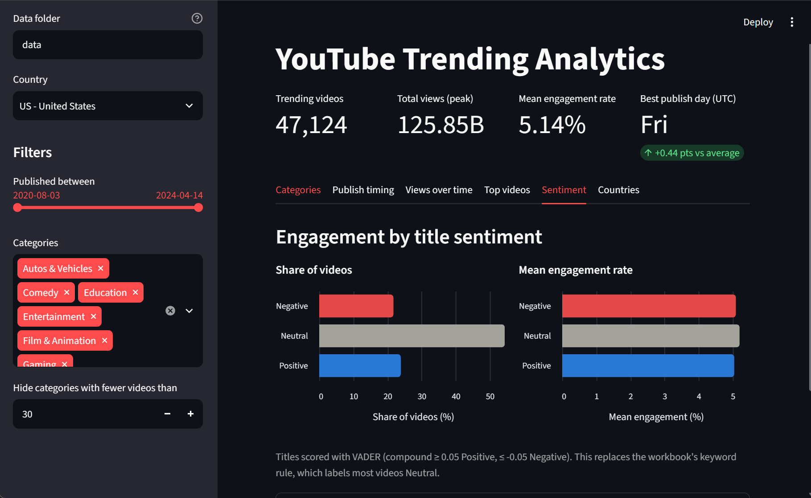
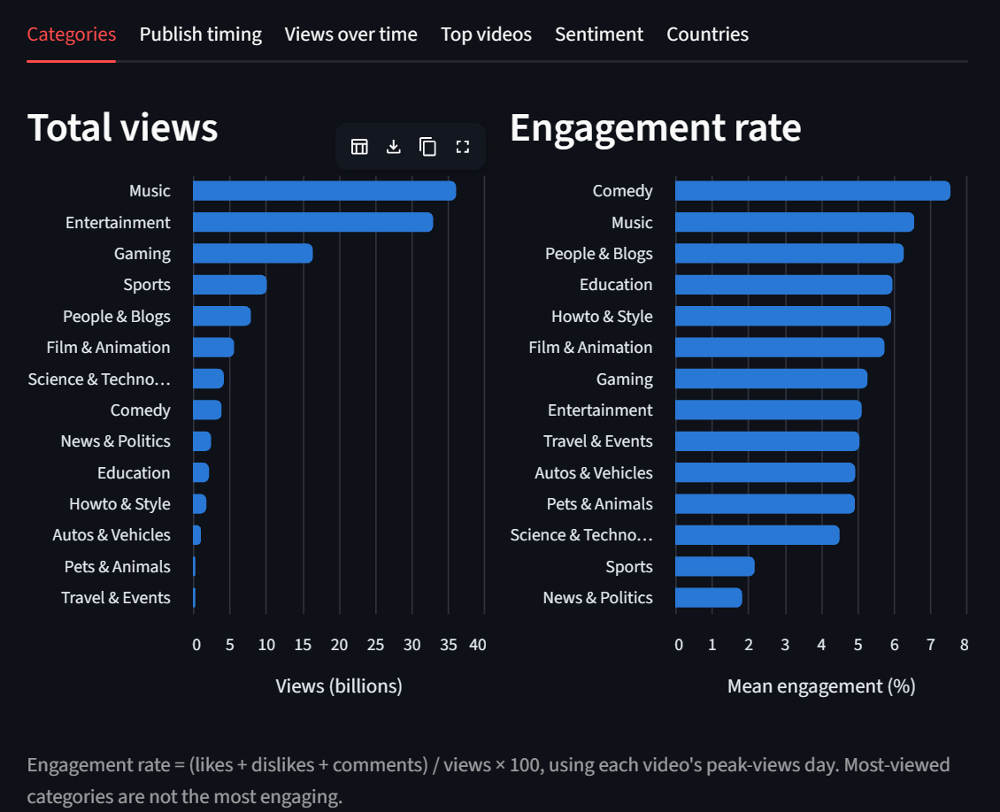
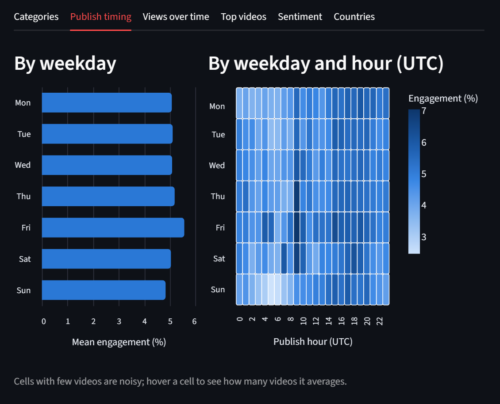
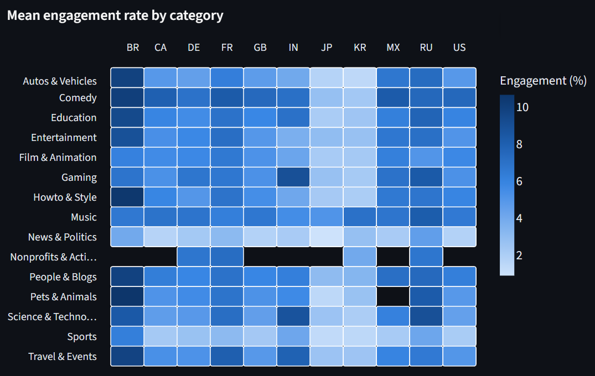

# YouTube Trending Video Analytics

An analysis of what separates YouTube's trending videos: which categories draw the most views, which ones draw the most engagement, whether publish timing matters, and how title sentiment and country change the picture. The data is prepared in Python, modelled in Snowflake, and explored in Tableau or in an interactive Streamlit dashboard.



## Data

[YouTube Trending Video Dataset](https://www.kaggle.com/datasets/rsrishav/youtube-trending-video-dataset) (Kaggle). The US file has **268,787 daily trending records covering 47,142 unique videos**, published between August 2020 and April 2024. The same dataset has files for other countries (GB, CA, IN, DE, FR, BR, MX, JP, KR, RU) in the same layout. The data is not included in this repo (the US file alone is about 400MB): download it and put the `<CC>_youtube_trending_data.csv` files in `data/`. An earlier iteration of the project used the older [2017-18 trending dataset](https://www.kaggle.com/datasets/datasnaek/youtube-new).

No data yet? `python make_sample_data.py` writes **synthetic** files in the same layout to `data/sample/`, so you can try every script and the dashboard. Its numbers are random and say nothing about real YouTube behaviour.

## Workflow

1. **Prepare:** split the large raw CSV into chunks under 200MB for upload (`01_split_large_csv.py`), and check that the chunks share the same columns (`02_list_columns.py`).
2. **Load and model in Snowflake** (`sql/`): load every country's files into one raw table, then build the tables the Tableau workbook reads (`US_YOUTUBE_VIDEOSFINAL` plus `CATEGORY_MAP`), an all-countries table, and a one-row-per-video view.
3. **Visualize:** in Tableau (`youtube_trending_dashboard.twb`, four worksheets: Engagement by Category, Publish Time vs Engagement, Views over Time, Top 10 Most Viewed Videos), or in the Streamlit dashboard (`app.py`), which reads the CSVs directly.

Metrics, defined the same way in Python (`trending.py`) and SQL (`sql/04_transform.sql`):
- **Engagement rate** = (likes + dislikes + comments) / views × 100
- **One row per video** = the trending day with the video's highest view count
- **Popularity tier** = Viral (≥ 10M views), High (≥ 1M), Medium (≥ 100K), Low
- **Sentiment:** VADER on the video title (see below). The workbook's original keyword rule on the description ("awesome" gives Positive, "fail" gives Negative) is kept in SQL and for comparison.

## Key Findings

Computed with `findings_check.py` from the raw US file, using one row per video and the engagement definition above.

- **Views and engagement don't line up.** Music and Entertainment lead in total views (36.1B and 33.0B). Comedy ranks only 8th in views but **first in engagement (7.6%)**, followed by Music (6.6%) and People & Blogs (6.3%). Entertainment, #2 in views, sits mid-pack at 5.1%. Sports (2.2%) and News & Politics (1.8%) are the least engaging categories.
- **Friday uploads had the highest engagement.** Average engagement for videos published on a Friday was 5.6%, against 4.8% to 5.2% on every other day, and Friday ranked first in **every year from 2020 to 2024**. Weekend uploads were slightly lower than weekdays (4.9% vs 5.2%).
- **Friday's lead is real, but engagement is drifting down.** Friday's engagement fell every year: 6.5% (2020), 5.9%, 5.3%, 5.2%, 5.1% (2024). That suggests engagement on trending videos overall has been declining, which is worth confirming year by year.
- **A title's tone barely matters.** Scored with VADER, 24% of titles read Positive, 54% Neutral and 22% Negative, and their engagement is almost identical: 5.0%, 5.2% and 5.1%. That 0.2-point spread is tiny next to the 1.8%–7.6% spread between categories, so *what* a video is about matters far more than how its title sounds. The workbook's old keyword rule labelled 97.6% of videos Neutral, so it couldn't have shown this. (`sentiment_analysis.py`)

### How countries compare

From `compare_countries.py` on all 11 countries in the dataset, sorted by mean engagement:

| Country | Trending videos | Mean engagement | Top category by views | Most engaging category | Best publish day (UTC) | Viral share (≥ 10M views) |
|---|---|---|---|---|---|---|
| Brazil (BR) | 39,501 | **7.8%** | Music | Comedy | Tue | 2.7% |
| Russia (RU) | 131,234 | 6.8% | Entertainment | Science & Technology | Thu | 1.0% |
| France (FR) | 54,166 | 6.4% | Music | Comedy | Sun | 1.9% |
| Mexico (MX) | 32,436 | 6.2% | Music | Comedy | Tue | 4.6% |
| Germany (DE) | 55,467 | 5.4% | Music | Comedy | Thu | 3.4% |
| Canada (CA) | 50,867 | 5.3% | Entertainment | Comedy | Fri | 4.3% |
| United States (US) | 47,124 | 5.1% | Music | Comedy | Fri | 4.1% |
| India (IN) | 78,844 | 5.1% | Entertainment | Gaming | Sat | 4.2% |
| United Kingdom (GB) | 47,591 | 4.8% | Entertainment | Comedy | Fri | 4.1% |
| South Korea (KR) | 28,249 | 3.1% | Music | Music | Wed | 2.5% |
| Japan (JP) | 32,094 | **3.0%** | Music | Music | Mon | 1.9% |

- **Comedy is the most engaging category almost everywhere:** in 7 of 11 countries. The exceptions are India (Gaming, 9.0%), Russia (Science & Technology, 9.0%), and Japan and South Korea (Music).
- **The Friday effect is English-speaking.** Friday is the best publish day only in the US, UK and Canada; the other 8 countries are spread across every other day of the week. Those three countries otherwise behave almost identically too (Comedy top, News and Sports bottom), so the US findings hold across English-speaking markets but not globally. Days are in UTC, which shifts local days for countries far from UTC (Japan and Korea are UTC+9), so treat the non-English best days as rough.
- **Engagement levels differ a lot by country**, from 7.8% in Brazil to 3.0% in Japan. Brazil has the highest rate in 9 of the 14 categories. Japan and South Korea are low in almost every category, with Music the clear exception (5.2% and 7.0%, against 6.6% in the US), possibly reflecting fan-driven engagement with music videos. Because baselines differ this much, compare categories within a country rather than raw rates across countries.
- **News & Politics and Sports are among the least engaging categories almost everywhere.** News is the lowest or second-lowest category in every country except South Korea, and Sports sits at 1.4%–4.2% everywhere except Brazil (6.3%).
- **Russia has the most trending videos but the fewest mega-hits:** 131,234 videos, over twice most countries, yet only 1.0% reach 10M views. Mexico has the highest viral share (4.6%), and India the most total views (194B).

## Interactive dashboard

```bash
pip install -r requirements.txt
python make_sample_data.py        # only if you don't have the Kaggle files in data/ yet
streamlit run app.py
```

Sidebar filters for country, publish date range and categories drive six tabs:

| Tab | Shows |
|---|---|
| Categories | Total views and mean engagement per category, side by side |
| Publish timing | Engagement by weekday, and a weekday × hour (UTC) heatmap |
| Views over time | Weekly views across trending videos, with hover |
| Top videos | The 10 most viewed videos with channel, category and engagement |
| Sentiment | Share of videos and engagement by title sentiment |
| Countries | Headline numbers per country and a category × country engagement heatmap |

The dashboard looks for data in this order: the raw Kaggle files in `data/`; the compact copy of the real data in `online_data/`; and finally the synthetic files in `data/sample/`, with a banner saying the data is synthetic.

### Online version

The raw files are too big for GitHub, so the online dashboard reads a compact copy of the real data in `online_data/`: one row per video (its peak-views day) plus weekly views per video, a few MB per country. `make_online_data.py` builds it from the raw files, and the tests check it gives the dashboard exactly the same numbers as the raw files.

```bash
python make_online_data.py data        # writes online_data/<CC>_videos.parquet and <CC>_weekly.parquet
```

The app is deployed on [Streamlit Community Cloud](https://streamlit.io/cloud) straight from this repository (`app.py` on `main`).

Screenshots from the real data (US unless noted):

**Categories:** the most-viewed categories (Music, Entertainment) aren't the most engaging (Comedy).


**Publish timing:** Friday leads, and the heatmap shows engagement by publish hour.


**Countries:** engagement by category across all 11 countries. Brazil (BR) is darkest almost everywhere, Japan (JP) and South Korea (KR) are pale except for Music, and News & Politics and Sports are light in nearly every country. Blank cells are categories with too few videos in that country.


## Title sentiment

`sentiment.py` scores each title with [VADER](https://github.com/cjhutto/vaderSentiment), a lexicon- and rule-based model built for short social-media text (compound score ≥ 0.05 is Positive, ≤ -0.05 Negative, otherwise Neutral). It replaces the workbook's keyword rule, which marks almost every video Neutral.

```bash
python sentiment_analysis.py data/US_youtube_trending_data.csv
```

This prints sentiment shares and engagement, a cross-tab against the old keyword rule, and the most positive and negative titles. VADER only understands English, so results are only meaningful for US, GB and CA; the dashboard warns about this for other countries.

## Comparing countries

```bash
python compare_countries.py data                      # every <CC>_youtube_trending_data.csv found
python compare_countries.py data --countries US GB IN
```

For each country: videos, total views, mean engagement, top category by views and by engagement, best publish day and share of viral videos, plus mean engagement per category and country.

## Snowflake SQL

| File | Does |
|---|---|
| `sql/01_setup.sql` | Warehouse, database, schema (`YT_WH`, `YT_DB`, `YT_SCHEMA`, as in the workbook), CSV file format and stage |
| `sql/02_load_raw.sql` | `RAW_TRENDING` table, and `COPY INTO` from the stage, taking the country from each file name |
| `sql/03_category_map.sql` | `CATEGORY_MAP` lookup |
| `sql/04_transform.sql` | `YOUTUBE_VIDEOS_ALL` (all countries), `US_YOUTUBE_VIDEOSFINAL` (exactly the columns the workbook reads) and the `VIDEO_PEAK` view |
| `sql/05_analysis.sql` | The headline findings, the weekday × hour grid, the country comparison and the top 10 in SQL |

Upload the files with SnowSQL first (`PUT file://data/chunks/*.csv @YT_STAGE`). Each file name must start with its country code: the Kaggle names already do, and for split chunks pass `--prefix US_part_` to `01_split_large_csv.py`.

These scripts were rebuilt from the workbook's schema, because the original load scripts were not kept. The tests run `03`-`05` in DuckDB (transpiled with sqlglot) on synthetic data and check every result against the pandas code, so the SQL and Python definitions can't drift apart. The `PUT` / `COPY INTO` load in `02` is Snowflake-only and isn't covered by the tests.

## Command-line scripts

Every script takes paths as arguments (run any of them with `--help`):

```bash
python 01_split_large_csv.py data/US_youtube_trending_data.csv --prefix US_part_ --out-dir data/chunks
python 02_list_columns.py data/chunks/US_part_*.csv     # exits non-zero if the schemas differ
python 03_clean_older_us_dataset.py data/USvideos.csv -o data/clean_USvideos.csv
python findings_check.py data/US_youtube_trending_data.csv
```

## Tests

The tests use small synthetic CSVs, so they run without the Kaggle data:

```bash
pip install -r requirements-dev.txt
ruff check .
pytest
```

They cover the prep scripts, the metrics, sentiment, the country comparison, the SQL (in DuckDB, compared against pandas) and a smoke test of every dashboard tab. GitHub Actions runs lint, the tests and every script on sample data on each push (`.github/workflows/ci.yml`).

## Limitations

- **Engagement norms vary by country.** Liking and commenting habits differ between countries and languages, so cross-country differences in engagement partly reflect audience culture, not just content.
- **Don't add views across countries.** The same video often trends in several countries, so per-country view totals overlap.
- **"Most engaging category" only counts categories with at least 1% of a country's videos**, so a few videos in a niche category can't top the ranking.
- **Dislike counts are mostly zero.** About 36% of rows have a non-zero dislike count, which fits YouTube hiding public dislikes in late 2021. Engagement rate is almost unchanged if dislikes are left out, and the findings above hold either way.
- **Sentiment is English-only and title-based.** VADER is a lexicon model, not a trained classifier; it misses sarcasm and most slang, reads hype words common in gaming and fight titles ("DESTROYS", "BRUTALLY") as negative, and is not meaningful for non-English titles.
- **Publish day and hour are in UTC** (from the dataset's `publishedAt` field), not the uploader's local time.
- **Popularity tier thresholds** (10M / 1M / 100K) are this repo's choice; the original thresholds behind the workbook's `POPULARITY_TIER` column weren't kept.
- The workbook's data connection points at Snowflake, and the account details have been replaced with placeholders. Tableau will ask you to reconnect to your own data source, and the worksheets will only render once you do.

## Repository Structure

```
├── 01_split_large_csv.py                # Splits a large CSV into <200MB chunks
├── 02_list_columns.py                   # Prints and compares CSV column headers
├── 03_clean_older_us_dataset.py         # Cleaning for the older (2017-18) US dataset
├── trending.py                          # Shared loading and metrics
├── sentiment.py                         # VADER title sentiment (+ the old keyword rule)
├── findings_check.py                    # Reproduces the headline US numbers
├── sentiment_analysis.py                # Engagement by title sentiment
├── compare_countries.py                 # Headline numbers across countries
├── make_sample_data.py                  # Synthetic Kaggle-style files for demos and tests
├── make_online_data.py                  # Compact copy of the real data for the online dashboard
├── online_data/                         # That compact copy (parquet), read by the online dashboard
├── app.py                               # Streamlit dashboard
├── sql/                                 # Snowflake setup, load, transform and analysis
├── docs/screenshots/                    # Dashboard screenshots used in this README
├── youtube_trending_dashboard.twb       # Tableau workbook (4 worksheets)
├── tests/                               # pytest suite on synthetic data
├── .github/workflows/ci.yml             # Lint, tests and script runs on every push
├── pyproject.toml                       # ruff / pytest config
├── requirements.txt
└── requirements-dev.txt
```

## Tech Stack

`Python (pandas)` `Streamlit` `Altair` `VADER` `Snowflake` `SQL` `DuckDB` `Tableau` `pytest` `GitHub Actions`
